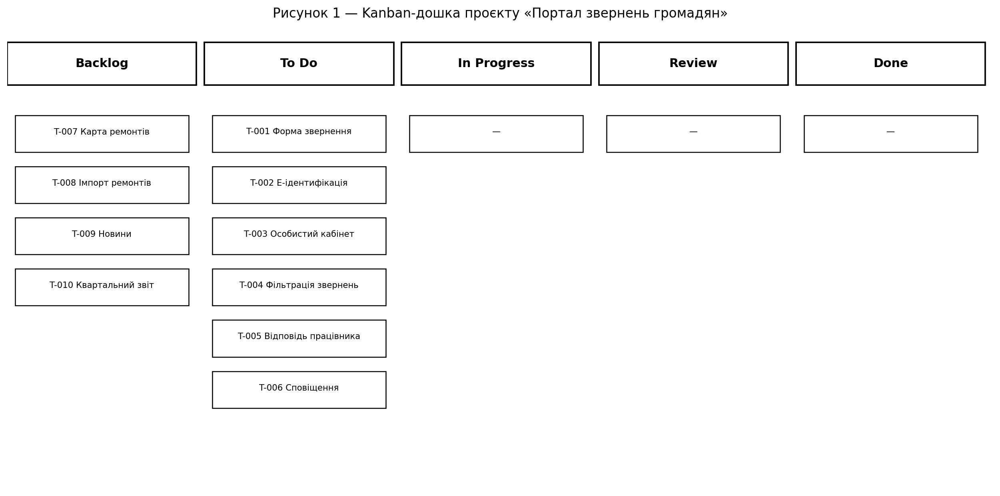

# Дошка задач і Sprint Plan

Інструмент: GitHub Projects. Колонки Kanban: Backlog → To Do → In Progress → Review → Done.

## Задачі (з FR-01—FR-10 ТЗ)

| ID | Задача | Label | FR |
| --- | --- | --- | --- |
| T-001 | Створити веб-форму з полями категорії, опису та адреси | Feature | FR-01 |
| T-002 | Додати завантаження фото до форми звернення | Feature | FR-01 |
| T-003 | Реалізувати інтеграцію з е-ідентифікацією | Feature | FR-02 |
| T-004 | Створити сторінку особистого кабінету зі статусом звернення | Feature | FR-03 |
| T-005 | Реалізувати автоматичне email/push-сповіщення | Feature | FR-04 |
| T-006 | Додати фільтр звернень за категорією та статусом | Feature | FR-05 |
| T-007 | Створити форму офіційної відповіді працівника | Feature | FR-06 |
| T-008 | Додати інтерактивну карту активних ремонтів | Feature | FR-07 |
| T-009 | Реалізувати імпорт щотижневого файлу ремонтів | Feature | FR-08 |
| T-010 | Додати фільтрацію новин за категоріями | Feature | FR-09 |
| T-011 | Реалізувати генерацію квартального звіту PDF/Excel | Feature | FR-10 |
| T-012 | Додати README та інструкцію запуску | Documentation | DoD |
| T-013 | Налаштувати CI-збірку та перевірку тестів | DevOps | DoD |
| T-014 | Виправити дефекти за результатами тестування | Bug | DoD |

## Sprint Goal

Реалізувати базовий наскрізний сценарій подання та первинної обробки звернення громадянина через веб-портал із використанням е-ідентифікації.

## Sprint Plan

| ID | Задача | Оцінка, год | Виконавець | Вимога |
| --- | --- | --- | --- | --- |
| T-001 | Веб-форма з категорією, описом і адресою | 5 | Оліферук Іван | FR-01 |
| T-002 | Завантаження фото до звернення | 3 | Оліферук Іван | FR-01 |
| T-003 | Інтеграція з е-ідентифікацією | 6 | Оліферук Іван | FR-02 |
| T-004 | Особистий кабінет зі статусом звернення | 5 | Оліферук Іван | FR-03 |
| T-006 | Фільтрація списку звернень за категорією та статусом | 4 | Оліферук Іван | FR-05 |
| T-007 | Форма офіційної відповіді та зміна статусу | 5 | Оліферук Іван | FR-06 |
| | **Разом** | **28** | | |

## Definition of Done для спринту

- усі задачі спринту мають статус Done на дошці;
- код пройшов Code Review;
- усі наявні юніт- та інтеграційні тести проходять успішно;
- відсутні відкриті критичні або блокуючі дефекти;
- README та технічна документація оновлені відповідно до змін;
- код злито в основну гілку без конфліктів;
- функціонал перевірено вручну за критеріями прийнятності відповідних FR;
- збірка проєкту успішно виконується в CI.
